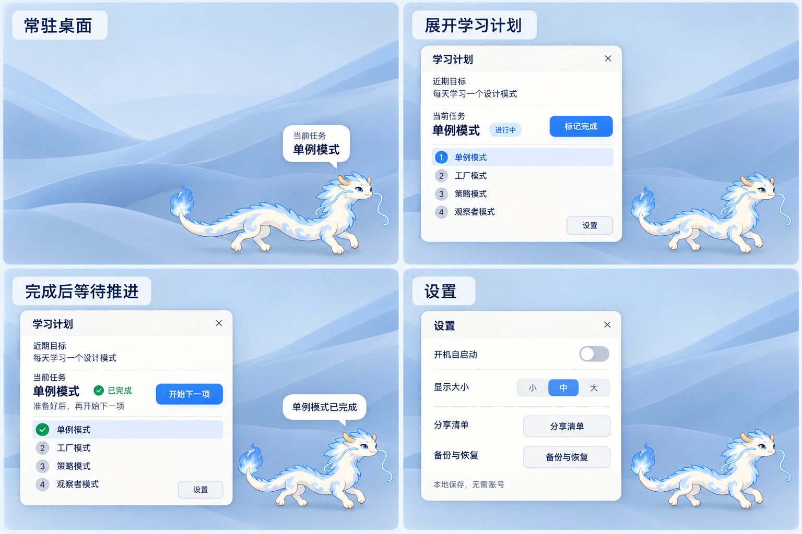

# 云龙学习搭子

面向 Windows 的桌面学习伙伴，使用 Godot 与 GDScript 开发。云龙展示当前学习目标，用户手动完成任务并推进下一项。

## 当前状态

已完成可运行的交互原型：透明宠物窗口、目标气泡、学习清单编辑、手动完成与推进、本地保存、大小设置，以及托盘接线。

皮肤、姿态与动画独立于学习逻辑，普通控件使用独立 Theme。当前只有静态云龙候选素材；正式动作需先拆解并验证身体结构再制作。

64 项自动检查通过，并在 Godot 4.7.2 / Windows 11 / Intel UHD Graphics 630 环境完成真实渲染及 Windows 导出验证。真实鼠标穿透、多屏、DPI 与 Windows 10 的实机验收尚未完成。

自启动、安装器、清单分享、用户备份恢复界面与正式动画尚未实现，原型中明确标记对应功能状态。

## 目录

- `desktop-pet/`：Godot 项目、测试和开发说明。
- `assets/cloud-dragon/`：角色候选、用户选定的原始参考、界面原型与来源记录。
- `docs/superpowers/`：需求、界面拆解、实施计划与执行记录。
- `build-prototype.ps1`、`test-prototype.ps1`：本地构建与回归检查入口。

详细操作与架构见 [项目说明](desktop-pet/README.md)，实测范围见 [验证记录](desktop-pet/docs/verification.md)。

## 开发

使用 Godot 4.7.2 标准版打开 `desktop-pet/project.godot`。提供的 PowerShell 脚本使用项目本地 `.tools/` 中的引擎和 Windows 调试模板；首次克隆需自行从 Godot 官方准备这些文件，位置见项目说明。

本地引擎、下载包、导出程序、测试数据、用户数据和原始运行日志不纳入 Git。界面截图及设计素材保留在仓库。正常用户数据位于用户目录，不应提交。

## 资源与许可

角色素材由本项目设计探索产生，仍为待校验候选；生成与修改来源记录在相应素材目录。Godot 引擎及其第三方依赖的许可说明在构建阶段生成，并应随可执行程序一起分发。本项目尚未选择对外开源许可证。
