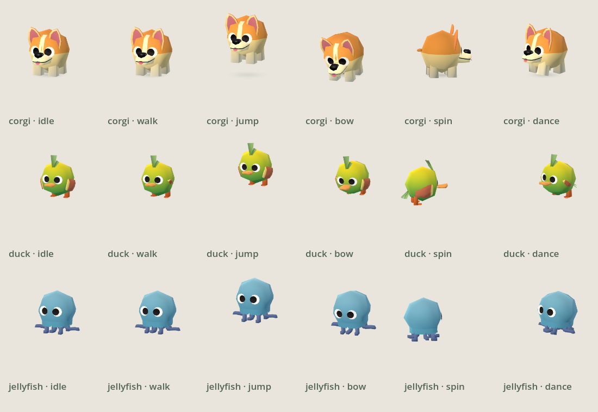
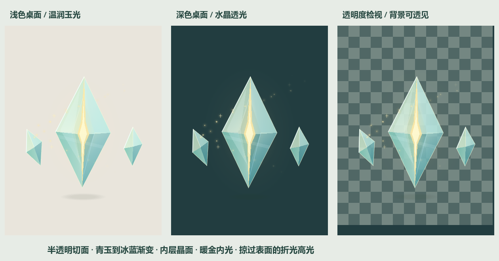

# 温玉灵核学习搭子

Windows / macOS 离线桌面学习伙伴。保留温玉灵核，新增柯基、小鸭、水母三个独立 3D 角色，支持骨骼动作、指针回应和持久化换肤；“引光”展开短暂光笺，显示当前学习目标。



设置 → 外观 → 陪伴形象可切换角色；动物拥有独立的待机、散步、张望、跳跃、致意、转圈与起舞。双击动物轻轻致意，闲置时会朝附近指针转向；拖动优先于动作。玉核保留原材质与渲染选择，并新增招手、亲昵、惊喜、小憩。素材来自 [Gobkit CC0 动物包](https://gobkit.itch.io/gobkit-free-animal-pack)，离线随程序打包，来源与哈希见 [调研记录](docs/research/2026-10-30-3d-companion-assets.md)。

柯基现已补充局部转头、眨眼、耳朵轻动与接触影，保留原始卡通比例和骨骼行走；[细化对照](desktop-pet/docs/screenshots/v0.17/corgi-refinement.png)。



## 安装与分享

当前版本 **v0.17**。执行 `./build-installer.ps1` 按需生成分发文件，输出位于 `desktop-pet/build/dist/`：

- `WarmJade-v0.17-Setup.exe`：发给别人即可安装，支持选择目录、桌面 / 开始菜单快捷方式和卸载。
- `WarmJade-v0.17-Portable.zip`：解压后运行 `WarmJade.exe`，无需安装 Godot。
- `SHA256SUMS.txt`：供分发核验文件完整性。

安装仅针对当前用户，不要求管理员权限。卸载保留学习进度。安装包与程序尚未签名；构建与验证范围见 [打包说明](desktop-pet/packaging/README.md)。生成的二进制不提交 Git。

## 按自己的节奏学习

学习页与设置页统一为浅玉色卡片。你可以追加任务、修订当前任务与目标、撤销当前项完成，已有进度会保留；整单替换仍会确认并重置进度。任务完成与开始下一项始终由你操作。

专注卡支持 5–120 分钟、暂停、继续和结束本轮。计时独立于任务进度，记录开始时的任务标题；隐藏宠物时继续，休眠后自动暂停，退出重启后手动继续。累计专注与可见陪伴时间分别记录。

设置分为外观、陪伴、桌面、数据与帮助。支持自然 / 安静陪伴、减少动态、30 / 60 FPS、置顶开关和三组外观搭配。自然模式闲置时偶尔轻轻活动；专注、菜单、拖动、打开面板时暂停自主表演。

数据页可导出不带进度的清单模板或带进度的计划备份，导入先预览再确认；可恢复最近备份或导入前计划。计划备份不包含外观设置与专注统计。设置与成长另有本地备份保护，主备均损坏时保留原文件并报告。详情见 [v0.16 说明与验证](desktop-pet/docs/release-v0.16.md)。

## 能量核心与互动

三块刚性晶体、内部能量与 23 个互动动作构成温玉灵核。温润玉晶、澄透水晶、幻彩欧泊支持 3D，也可切回 2D。专注时内部光线平稳收敛，减少动态时悬浮与粒子运动更慢；主动预览保留完整动作。形象原则见 [能量核心结构](desktop-pet/docs/energy-core-structure.md)。

设置中可开关桌面图标感知：只读位置，停留在图标附近时轻轻转向，遮挡时尽量移开，不读取文件内容。新增行走、捧腹大笑、跳跃、连跳、回旋、摇摆，点击或设置页可预览；全部动作结束回悬浮。详见 [图标与动作说明](desktop-pet/docs/icon-awareness-v0.11.md)。

## 粒子成长

玉核从开始就具备内部晶纹、通透层次和折光高光。成长只让粒子从 28 枚渐增到 72 枚，并增强微光；默认累计 40 小时有效陪伴达到上限。隐藏、休眠和离线不累计，退出时保存进度，不掉级。

## 操作

设置页支持四档“全局界面字号”：正常（当前默认）、大一点（120%）、戴眼镜（145%）、老年人（170%）。设置、学习计划、任务列表、编辑输入框、确认弹窗和应用菜单即时同步并记住选择；大字号使用应用绘制的菜单。

“隐藏宠物”保留后台托盘入口；Windows 主窗口 / 任务栏的“关闭”和托盘“退出”会保存后真正结束程序。隐藏图标面板中的托盘菜单使用 Windows 原生菜单接口。

轻点切换当前角色的动作；玉核共有 23 个动作。按住拖动。右键进入学习计划、设置或退出。点击引光光笺打开计划，完成当前项后手动推进下一项。

设置页支持实时换装预览、开机自启动、50% / 75% / 100% / 125% 大小和动作预览，采用浅玉色分组布局。安装版使用固定程序名，升级前先退出旧版。数据保存在 `%APPDATA%\CloudDragonStudyPrototype`，不要把个人数据一起打包给别人。

## macOS 支持

已添加 macOS 自启动、Universal 导出和本地签名 / 可选公证打包流程。首版关闭桌面图标感知；真实 Mac 的置顶、菜单栏和安装验收仍待完成。Mac 上执行 `bash test-macos.sh` 和 `bash build-macos.sh`，详见 [Mac 构建与朋友试用说明](desktop-pet/packaging/MACOS.md)。

Windows 直接打包朋友试用版：`python scripts/build-macos-friends.py`。生成 `desktop-pet/build/macos/WarmJade-Friends-macOS-0.16.zip`，使用本地签名，不需要 Apple 开发者证书。

## 开发与验证

```powershell
./setup-dev.ps1
./test-prototype.ps1
./build-prototype.ps1
./setup-installer-tools.ps1
./build-installer.ps1
./desktop-pet/packaging/test-installer.ps1
```

使用 Godot 4.7.2 标准版打开 `desktop-pet/project.godot`。本地开发可运行“启动温玉灵核.cmd”。本地引擎、编译器、下载包、导出程序及测试数据位于忽略目录，不纳入 Git。

- [项目操作与模块说明](desktop-pet/README.md)
- [全部动作轨迹及水晶材质](desktop-pet/docs/jade-motion-v0.8.md)
- [设置页优化](desktop-pet/docs/settings-v0.9.md)
- [形象设计资料](assets/companions/warm-jade-core/2026-10-26/README.md)
- [本轮开源项目调研](docs/research/2026-10-30-open-source-desktop-pets.md)、[产品体验调研](docs/research/2026-10-30-companion-experience.md)、[升级设计](docs/superpowers/specs/2026-10-30-companion-v016-design.md)

Godot 引擎与第三方许可随安装版和便携版分发。本项目尚未选择对外开源许可证。云龙 / 玉龙的旧实现、专属资源与历史构建已移除；当前只维护温玉灵核和三个动物伙伴。
