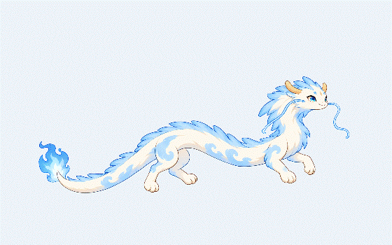

# 云龙学习搭子

面向 Windows 的桌面学习伙伴，使用 Godot 与 GDScript 开发。云龙展示当前学习目标，用户手动完成任务并推进下一项。

## 当前状态

已完成可运行的交互原型：透明宠物窗口、目标气泡、学习清单编辑、手动完成与推进、本地保存、大小设置，以及托盘接线。

皮肤、姿态与动画独立于学习逻辑，普通控件使用独立 Theme。现有云龙使用 36 个控制关节，支持游动、抬头、舒展、收拢与欢腾，包含双须、鬃毛、五段尾部及分束尾焰。原始美术保持不变，换色外观继续共享骨架、动作库和材质规则。

左键云龙切换动作，左键气泡或右键云龙打开计划；支持 50% 更小档，拖动每帧限制完整窗口在屏幕工作区内。127 项自动检查通过，实际渲染与导出范围见验证记录。真实鼠标穿透、多屏、DPI 与 Windows 10 的实机验收尚未完成。

新美术已选择 **C 玉骨天龙**，见[细化图与结构归档](assets/cloud-dragon/redesigns/2026-10-22-jade-dragon/README.md)。它尚未接入运行皮肤。用户要求进一步实现全身细致传力与收势，下一版以[全身动作规格](docs/superpowers/specs/2026-10-22-jade-dragon-whole-body-motion.md)为准；当前风动基线不代表该规格已完成。

自启动、安装器、清单分享、用户备份恢复界面与完整多视角分层动作尚未实现，原型中明确标记对应功能状态。

## 目录

- `desktop-pet/`：Godot 项目、测试和开发说明。
- `assets/cloud-dragon/`：角色候选、用户选定的原始参考、界面原型与来源记录。
- `docs/superpowers/`：需求、界面拆解、实施计划与执行记录。
- `build-prototype.ps1`、`test-prototype.ps1`：本地构建与回归检查入口。

详细操作与架构见 [项目说明](desktop-pet/README.md)，实测范围见 [验证记录](desktop-pet/docs/verification.md)。

## 开发

换电脑从 [HANDOFF.md](HANDOFF.md) 开始。准备 Git 与 Python 3.10+，克隆后运行 `./setup-dev.ps1`，自动准备固定版本引擎与 Windows 调试模板；再运行 `./test-prototype.ps1` 和 `./build-prototype.ps1`。使用 Godot 4.7.2 标准版打开 `desktop-pet/project.godot`。

当前产物为 `desktop-pet/build/CloudDragonPrototype-v0.4.exe`；双击“启动云龙原型.cmd”运行。启动新版前先从旧版托盘退出。当前动作与换色复用见 [v3 风动手册](desktop-pet/docs/wind-and-tail-v3.md)，旧姿态候选保留在 [poses](assets/cloud-dragon/poses/README.md)。开源项目参考见 [调研笔记](docs/research/desktop-pet-projects.md)。

本地引擎、下载包、导出程序、测试数据、用户数据和原始运行日志不纳入 Git。界面截图及设计素材保留在仓库。正常用户数据位于用户目录，不应提交。

## 资源与许可

角色素材由本项目设计探索产生，仍为待校验候选；生成与修改来源记录在相应素材目录。Godot 引擎及其第三方依赖的许可说明在构建阶段生成，并应随可执行程序一起分发。本项目尚未选择对外开源许可证。
