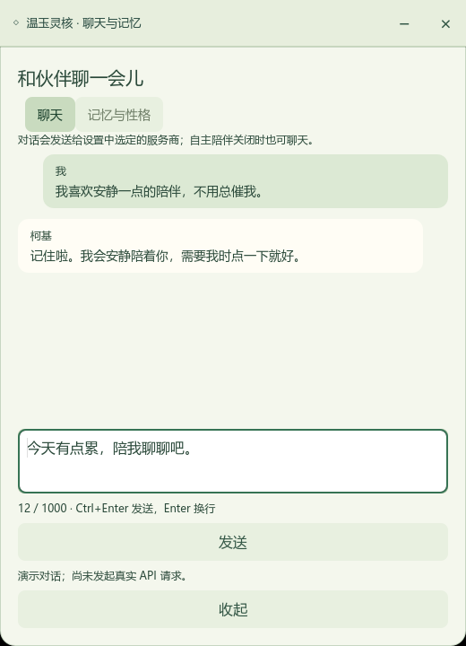

# AI 陪伴、聊天与记忆

## 连续自主行为

伙伴现在维护各自的模拟精力、好奇与互动需求：活动后消耗精力，休息恢复精力，探索降低好奇，点击和聊天满足互动需求。它会据此选择探索、玩耍、休息或互动；设置 → 陪伴的“伙伴此刻”显示简短意图。

AI 每次可返回一个意图、当前动作和最多三步后续动作，随后按原来的 10～20 秒节奏执行。没有待执行计划时，本地依据状态加权选择，全部动作仍有机会出现。点击、打开窗口或切换角色会打断旧计划。模型调用仍至少间隔 120 秒，避免每个动作都产生请求。

这些是模拟状态，不代表真实主观感受；状态在当前运行期间按角色保留，重启重新开始。已保存的长期偏好、伙伴性格和聊天记录仍会跨重启恢复。发送给模型的新增内容仅为这些数值、简短意图及动作名称。

## 开始使用

设置 → 陪伴 → AI 陪伴，选择 DeepSeek 或 OpenAI，填写 API Key，从下拉框选择模型，点击“保存并测试连接”。测试只发送最小角色状态，不发送已有对话或记忆。模型必须支持 Chat Completions 的 JSON 输出；DeepSeek 默认选中 `deepseek-flash`，另可选择 `deepseek-v4-pro`。点击“刷新可用模型”会向当前服务商官方 `/models` 接口查询，以返回的 `id` 而非展示名称作为请求模型。OpenAI 需填写自己的密钥并刷新；列表过滤已知非聊天模型，最终以连接测试为准。切换服务商会清空旧密钥，刷新失败保留当前选择。

“启用自主 AI 陪伴”控制空闲时自动选择动作，不影响手动聊天。自主决策默认最多每 120 秒一次，连接测试至少间隔 10 秒，聊天至少间隔 2 秒；每次只保留一个对话或决策请求；短动作超时 10 秒，聊天超时 45 秒，不自动连续重试。关闭、未配置或失败时可继续使用本地动作。2026-10-30 已通过 DeepSeek 官方模型列表、真实动作请求、多轮聊天与偏好上下文实测；OpenAI 使用模拟回归，未做真实账户测试。

## 新的桌面交互

- 轻点伙伴主体，直接打开聊天与记忆，同时换一个动作回应；连续点击尽量选择不同动作。
- 主动短话最多 72 字，通常一至四行，按长度停留 6～18 秒；关闭按钮或右键只收起提示。
- 右键 → 和伙伴聊聊，也可打开聊天。双击保留致意；按住拖动。
- 查看学习目标使用独立菜单，打开学习计划。“引光”改为短暂柔和光效，不再拉出文字卡片。
- 专注、安静或减少动态时不主动发话，但仍可手动点击聊天。

聊天支持 Ctrl+Enter（Mac 为 Cmd+Enter）发送，Enter 换行；等待时显示已耗时，可点击停止。失败会说明密钥、模型、额度、限流或网络问题，并保留输入用于重试。每个伙伴保留自己的窗口内草稿，切换回来继续编辑；未发送草稿不会写入磁盘。

## 连续对话与长期喜好

聊天按当前角色分别保存，每个伙伴保留最近 20 轮完整对话；请求携带最近 6 轮左右的上下文（最多 12 条历史消息，当前消息占用其一）。各伙伴共享你的长期喜好，但保持各自的稳定性格。每条用户消息最多 1000 字，回复最多 800 字。

例如说“我喜欢安静的陪伴，请记住”，模型可以返回对这句话的明确偏好摘录。程序只接受当前消息中实际出现的偏好语句，不把推测、临时待办、密码或标识信息自动变成记忆。最多保存 20 条长期喜好，每条 160 字；伙伴性格可编辑，最多 600 字，清空并保存恢复默认。

聊天窗口的“记忆与性格”页可以修改、删除喜好及伙伴性格。删除长期喜好不会删除聊天原文；需要移除历史内容时，也可清空当前伙伴的对话。清空对话会先确认，并保留长期喜好与性格。失败、取消、切换伙伴或关闭聊天时，旧请求失效，未发送成功的输入保留。

## 哪些内容发送给 API

自主陪伴只发送当前角色、闲置区间、是否专注、最近动作、事件类型，以及你已保存的喜好和当前伙伴性格。聊天另外发送最近对话和本次输入。不会主动读取或发送屏幕、文件、学习目标和任务标题。

动作必须来自当前角色已有的安全动作列表；模型不会执行代码、创建动画、修改学习进度或绕过拖动／专注／菜单等本地控制。自然语言建议不等于执行权限。

## 本机文件与隐私

设置 → 数据与帮助 → 打开数据目录，可查看：

- `ai_private.cfg`：独立 JSON 配置，包含服务商、模型、开关和**明文 API Key**，重启后恢复。
- `ai_memory.json`：私有对话、长期喜好和伙伴性格。

两者不混入普通 preferences.cfg 或学习计划备份，不产生包含密钥的 .bak；使用临时文件写入后原子替换。在支持的 POSIX 平台限制为当前用户读写。损坏记忆文件保留，不自动覆盖；备份并移走损坏文件后可重新保存。

Git 忽略这两个文件及临时文件，Windows／Mac 的导出配置都明确排除它们，安装和便携打包只复制程序及许可文件。请勿手动强制加入 Git 或分享用户数据目录。

## 开发验证

运行 `./test-prototype.ps1` 或 `bash test-macos.sh`。AI 专项为 test_ai_core、test_ai_models、test_ai_memory、test_ai_settings、test_ai_chat_ui、test_ai_bubble、test_ai_integration、test_ai_chat_integration、test_ai_interaction。测试全部使用隔离目录和假密钥，不调用付费 API。

`tests/preview_ai_companion.gd` 在真实图形后端生成界面预览。分发包验证同时检查三个伙伴可渲染、AI 私有文件未打包。Windows 验证不替代 Mac 真机验证。

接口依据：[OpenAI Chat Completions](https://developers.openai.com/api/reference/resources/chat/subresources/completions/methods/create)、[DeepSeek Chat Completions](https://api-docs.deepseek.com/api/create-chat-completion/)。

显式实测入口：`scripts/test-ai-live.gd`，要求 `AI_LIVE_CONFIG` 指向本机私有配置、`CLOUD_DRAGON_DATA_DIR` 指向独立测试目录。运行一次查询模型列表及三次真实生成请求，只发送专用测试语句，不加载用户原有对话；不纳入默认回归。

模型列表依据：[DeepSeek Models](https://api-docs.deepseek.com/api/list-models/)、[OpenAI Models](https://developers.openai.com/api/reference/resources/models/methods/list)。

## 开发阶段的活泼动作

本地自动动作开放当前角色的全部表演动作，空闲 10～20 秒触发一次，避免连续重复。开启 AI 后本地动作仍继续，AI 请求期间暂停本地调度，AI 决策最多每两分钟一次并排除最近三次 AI 动作。拖拽只由鼠标触发；专注、安静、减少动态与面板打开时仍暂停自主活动。

散步、漫游、环绕、螺旋、交错会移动桌宠窗口，目标可选当前屏幕整个可用区域，速度约每秒 115～155 像素；每帧按完整窗口约束边界。其他动作保留原地表演，多屏在当前屏幕内行走，拖到另一屏后以新屏幕为活动区域。

作息使用电脑本地小时：07–10 时偏舒展与苏醒，10–18 时偏探索，18–22 时偏互动，22–07 时偏休息。睡意会随活动累积，休息降低；点击/聊天提升注意力，注意力逐渐回落。强疲劳可中断旧的游玩计划。时间段仅影响偏好，不封锁动作；开发阶段继续保持活泼节奏。

## 更多交流与认识你

聊天通常先回应你的话，再自然展开两到五句；仍尊重已保存的简短回复偏好。伙伴可在合适时问一个关于兴趣、陪伴方式或日常习惯的问题，参考已有记忆，避免连续盘问、追问未回答的问题或索取敏感资料。主动气泡参考该角色最近三条发言，完全重复的文字不会再展示。

点击主体或主动气泡进入聊天，可直接回答刚才的问题。问题会随这轮回答作为上下文保存、重启后恢复；清空当前伙伴的聊天同时清除待答话题。尚未回答的主动话题和最近发言只保留在本次运行中。明确表达的偏好仍按原有规则提取，未表达的信息不擅自记成事实。
