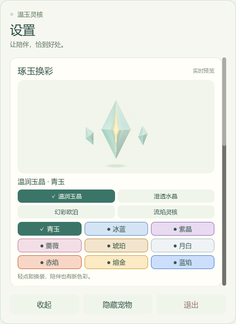
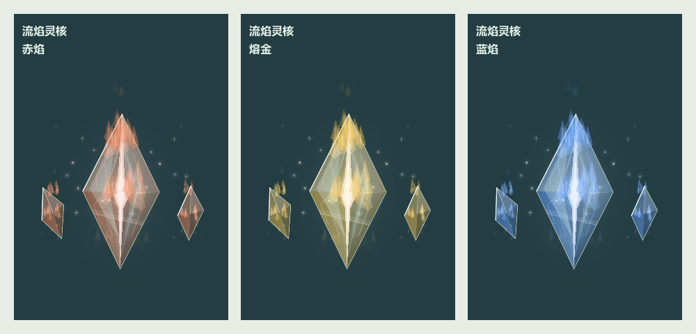
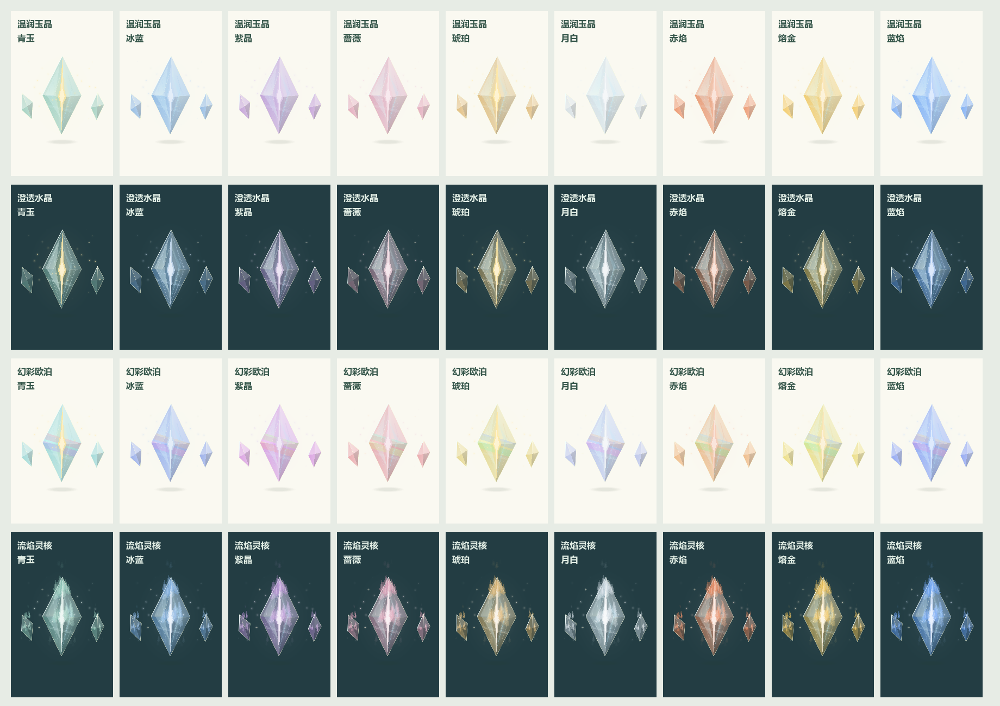
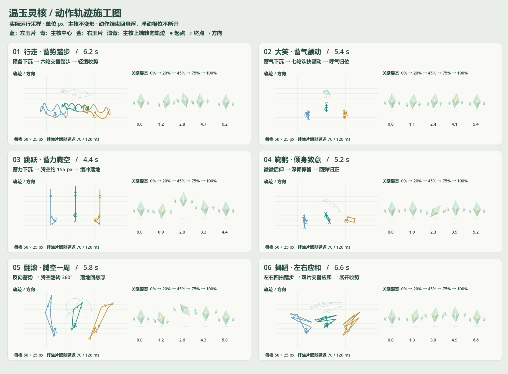

# v0.13 换装、粒子火焰与动作细化

设置顶部的“琢玉换彩”可直接选择材质和颜色；点击即应用，退出及重启后保留。材质与颜色独立组合，不重建角色，不打断当前动作或重置陪伴成长。

- 材质：温润玉晶、澄透水晶、幻彩欧泊、流焰灵核。
- 颜色：青玉、冰蓝、紫晶、蔷薇、琥珀、月白、赤焰、熔金、蓝焰。
- 水晶使用更透明的切面和内部折线；欧泊具有缓慢变化的虹彩；火焰由主核和两侧玉片发出的上升粒子组成。
- 火焰粒子随生命周期摆动、上升和渐隐，保持玉核轮廓。初始 96 枚，陪伴成长后最多 136 枚；原有微光粒子仍按成长规则变化。
- 预览使用与桌宠相同的渲染代码，隐藏设置时停止推进与渲染。透明预览采用预乘透明混合，避免水晶和粒子发黑；像素对比检查覆盖四种材质。

动作新增鞠躬（5.2 秒）、翻滚（5.8 秒）与舞蹈（6.6 秒），现在共 15 个可选互动动作。行走和大笑加入下沉准备、主要动作和落地回弹；翻滚完整转一周再收势。全部动作结束回到持续悬浮。

轨迹图来自实际动画的 201 帧采样；对应数据为 `screenshots/refined-motion-blueprint-v0.13.json`。早期动作见 v0.8、v0.11 图纸。

验证入口：`test-prototype.ps1`；原生渲染对比 `tests/check_preview_render.gd`；材质图 `tests/preview_appearance.gd`；动作图 `tests/draw_motion_blueprint.gd -- --refined-motions`。

透明合成接口依据：[CanvasItemMaterial](https://docs.godotengine.org/en/stable/classes/class_canvasitemmaterial.html) 与 [Godot viewport alpha issue](https://github.com/godotengine/godot/issues/99715)。
