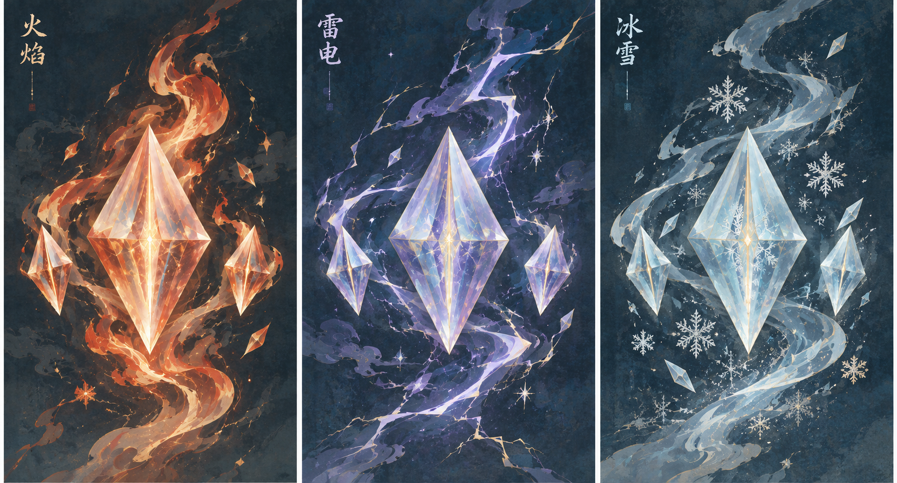
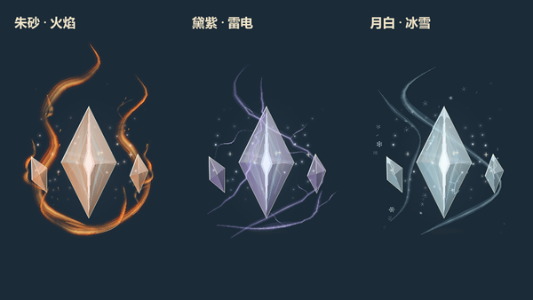
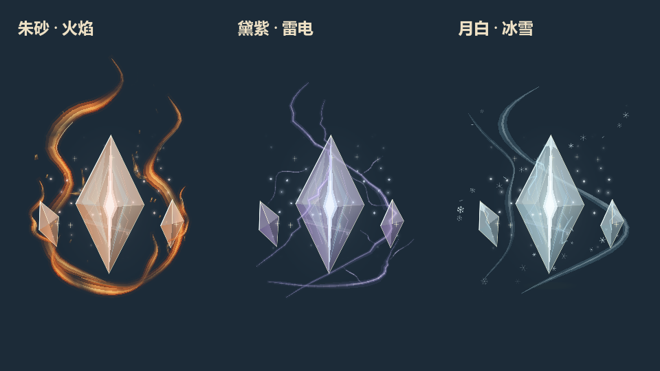
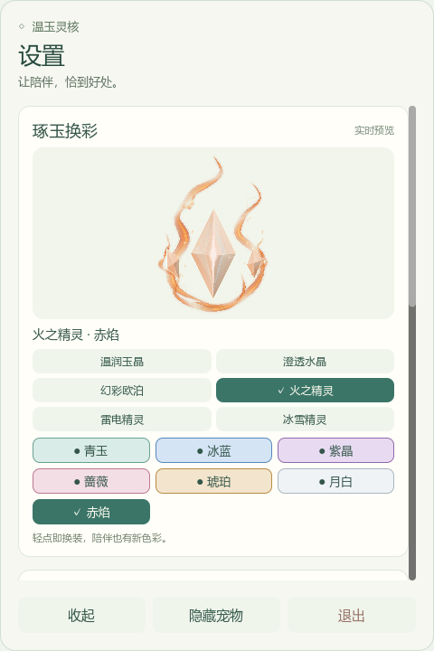

# v0.14 国风动态元素主题

火焰、雷电和冰雪都保留原始主核及两侧玉片。设置中选择主题后立即显示对应效果，配色、成长进度与当前动作继续保留。

- **火之精灵**：三条主火带、两条侧焰和四条独立卷焰前后环绕完整晶体。热光与透明断笔沿火带推进，短卷焰上升并渐隐；18 枚余烬随陪伴成长增至 30 枚，具有独立尾迹和寿命。
- **雷电精灵**：不对称的黛紫雷光、连续分叉与沿电流游走的高光。电弧形状平滑演化，保留晶体切面，不做逐帧随机拓扑切换或急促频闪。
- **冰雪精灵**：月白冰雾分成两条不同流向的云气带，边缘霜脉缓慢伸展，32 枚雪花与冰片分层漂移。稀疏粒子保留桌面点击穿透。

所有特效均由实时计算的曲线、颜色、粒子及程序化笔触着色器绘制。概念图只记录美术方向，不作为实时特效的整帧图片使用。切换动作时共用连续的时间相位；暂停交互时笔触时钟同步暂停。

当前有 6 种材质、7 种颜色。移除“熔金”和“蓝焰”选项；旧设置中的“火焰＋熔金”升级为“雷电＋紫晶”，“火焰＋蓝焰”升级为“冰雪＋冰蓝”。其余旧配色的最近似颜色保持可用。

15 个互动动作与 [v0.13 动作轨迹](screenshots/refined-motion-blueprint-v0.13.png) 保持一致。统一绘制边界容纳跳跃和翻滚中的效果，主题切换不重建角色、不重置动作。

验证入口：`test-prototype.ps1`、`tests/check_flame_flow.gd`、`tests/check_element_effects.gd`；原生颜色对照 `tests/check_preview_render.gd`；动态录制 `tests/preview_element_flow.gd` 和 `tests/assemble_preview.py`。动态预览为 24 FPS 的五秒实机采样，应用运行帧率另用 `tests/measure_motion.gd -- --fire-spirit` 测量。

本机 Intel UHD 630 的满成长桌面本体采样：360 帧平均 54.12 FPS，P95 22.70 ms，最大单帧 191.05 ms；这是当前测试环境的结果。静止时复用最多 1/30 秒的火焰几何，笔触着色器仍逐帧流动；动作、雷电和稀疏雪粒逐帧更新。火焰遮罩额外覆盖这段保留时间内的余烬位移，避免裁掉粒子边缘。
