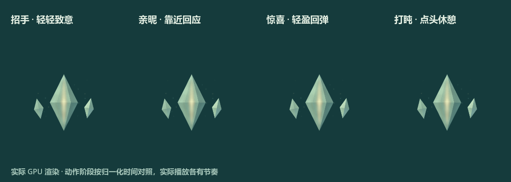

# v0.17 动作与情绪交互增强

用户要求先收集资料、总结，再改进，并在20分钟内提交。基线 `d114f78`；本轮和经用户授权协调的动物伙伴升级一起提交。

## 依据与选择

[研究记录](../../docs/research/2026-10-30-expressive-interactions.md)核对了 Bongo Cat 的即时敲击回应、Desktop Mate 的追指针/摸头、VPet 的陪伴框架，以及 Adobe 的预备、跟随、错峰、缓动原则。公开评价/星数表示产品热度，没有据此编造单个动作的排行榜。

选择在三块刚性玉晶上表达可读的情绪：核心是身体，伴生片是回应的姿态；通过节奏、相对运动与能量强弱表达意图，保持玉体结构。

## 新动作和操作

- **招手 greet，3.4秒**：先轻轻准备，玉片交替致意、核心点头，再收势。
- **亲昵 nuzzle，3.8秒**：温和靠近、停留回应，小幅反向回弹后回悬浮。
- **惊喜 startle，2.8秒**：先微小压低，快速抬起和展开，再用更小的落定回弹缓冲。
- **打盹 doze，6.4秒**：玉片收拢，核心两次慢点头，内光变柔，再归位。
- 感知、舒展、收息也补上更明确的预备、保持和释放阶段；单击循环与设置预览中玉核共23动作。

新增双击招手、中键亲昵；靠近时柔和注视，停留约1.2秒可招呼一次。沿玉核左右轻扫形成亲昵，快速靠近可引起克制惊喜。细小抖动不会累计为抚摸；中心有平滑关注过渡，避免鼠标在正中左右1像素引起姿态翻转。

自动回应至少等待6秒有效观察冷却，静止悬停不反复问好。菜单、拖动、打开面板、隐藏、专注、安静/减少动态或正在表演时不抢占；长间隙清空手势，不补发。显式双击/中键是用户主动操作，仍可触发。引光上的点击继续打开计划；没有读取键盘输入或修改学习任务。

## 实际预览

这是实际 GPU 的73帧动画。四个动作以归一化阶段对照，便于比较姿态；运行时分别按上述实际时长播放。

## 验证

- 新动作专项：235,580检查，零失败；覆盖30/60/120Hz归位、七通道首尾归零、刚体单位长度、核心/玉片不穿插、边界与不同姿态。
- 手势模型：最初失败后实现，最终122检查零失败；中心关注抖动回归也经历先失败再通过。
- 完整 `test-prototype.ps1` 通过，包含既有数据/字号/学习/专注、合并动物伙伴和新增动作/手势/输入路由检查。
- 实际 GPU：23动作透明裁切零失败；2D/3D共1,368中心采样，最大误差约0.0000464像素，均回悬浮；原有空间动作/打断检查继续通过。
- 73帧GPU预览已实际生成并查看；聚焦代码审查无阻塞问题，中心注视跳变已修复。生成/写入预览失败会明确退出失败。

研究、设计、实现、测试和截图纳入Git。现有逻辑仍为 Godot 实时程序化动画，不宣称人体动力学或真实玉石物理仿真。Mac真机、多屏和所有设备的主观自然感仍不由本机有限样本替代。
