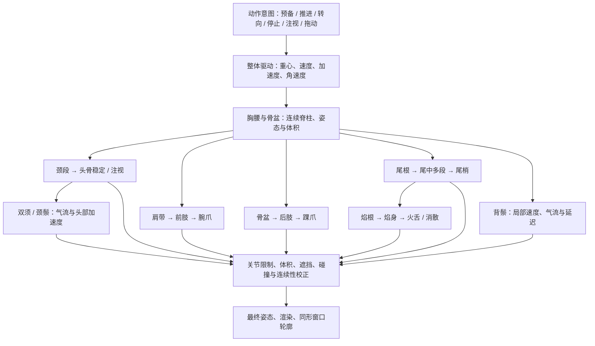

# 玉骨天龙 · 全身动作与传力规格

日期：2026-10-22。用户已选 C 玉骨天龙，并明确要求：**不只是尾巴，所有部位都需要细致的力传导和动作；不能只靠整图浮动、各部位周期摇摆或增加关节数量。** 本规格作为下一版玉骨天龙绑定和动作制作的验收依据。

状态：新形象已有定向细化稿；当前 v0.4 运行原型完成的是旧素材的风动 / 分段尾焰基线，**尚未完成本规格的全身动力学、分层美术和动作编排**。不得把 36 个控制关节、有限几何测试通过或短时帧率当作本规格已经实现。

## 视觉目标与现实约束

表现清冷、有重量的上古神兽在气流中穿行。角、头骨和鳞甲有硬质体积，颈躯干可弯曲，四肢有肌肉张力，须、鬃毛与焰有不同软度。自由浮游的驱动力来自设定中的玄幻浮力；惯性、关节连接、弯曲连续、拖曳和回弹仍遵守一致的物理直觉。不是机械套用陆生动物走路，也不是长期不停划水的四条腿。

每个动作先明确：意图是什么、主动发力处在哪里、支点在哪里、重心怎么改变、哪些部位先动、哪些部位被动跟随、何时收势。没有这些拆解，不开始制作新姿态。

## 从整体到局部的运动层次

“先看再转头”属于主动预备，“尾梢在躯干停下后继续摆”属于被动惯性；两者应分开处理。传力不等于每个动作都从头开始，也不等于把同一正弦波复制给所有关节。

## 逐部位拆解与验收

| 部位 | 主动控制 / 被动响应 | 细节与禁止事项 |
| --- | --- | --- |
| 头骨、角、眼眶 | 注视目标与姿态稳定，受颈部带动 | 角和颅骨保持刚性；躯干起伏时头部适度反向稳定，不能像果冻被拉长 |
| 眼、眼睑、下颌 | 注视、眨眼、轻微呼吸等独立表演层 | 先看后转可提供预备；不是用整个眼球贴图缩放代替闭眼；表情不能改变头骨轮廓 |
| 颈部 | 从肩向头多段弯曲；受头部意图和身体惯性共同影响 | 颈根、颈中、颈上连接连续；头转到极限时肩带接力，不能在喉部形成锐折 |
| 肩带、胸腔 | 前肢发力与躯干的传递节点 | 前腿变化先体现肩关节和上臂，胸腔体积保持，不能只转爪子或把前腿根拉到喉部 |
| 胸腰 | 控制重心、弯曲和推进 | 胸段较稳、腰段更灵活；弯曲沿脊柱连续分布，横截面不突然变薄，避免一处铰链折腰 |
| 骨盆 | 后肢和尾根共同的受力支点 | 参与推进与收势，不能尾根摇而骨盆完全无响应；后腿始终来自髋部 |
| 前肢 | 肩 → 上臂 → 肘 → 前臂 → 腕 → 爪 | 滑翔中略收肢，转向时协助平衡；腕爪比上臂稍后跟随；近远侧幅度与时机不同，不能整条腿像纸片转动 |
| 后肢 | 髋 → 大腿 → 膝 → 小腿 → 踝 → 爪 | 蓄势时屈曲，推进时放开，滑翔时回收；膝 / 踝弯曲方向明确；悬浮时不把脚锁死在不存在的地面 |
| 尾部 | 尾根响应骨盆，逐段传播到尾梢 | 新模型建议从 8–12 个控制段试绑；相邻曲率连续，柔度向尾端增加，停止后仍有逐渐衰减的余摆。段数服从轮廓和曲率验收 |
| 双须 | 固定须根；气流、头部转向与加速度引起拖曳 | 每须用连续曲线 / 多节点约束控制，靠根较稳、末端更软；左右错相，不能同步像雨刷；不穿脸、不从鬃毛长出 |
| 颈鬃、背鬃 | 按附着位置接受局部速度和相对气流 | 先分大毛束再做束内末梢；根不脱皮，各束有轻重差，不能整排像同一把扇子开合；骨角与鳞甲排除在软毛影响场外 |
| 尾焰 | 焰根依附尾端，焰身拖曳，火舌独立卷动与消散 | 不是刚性火焰贴图随尾巴转。主体 / 左右火舌 / 细丝分层；新生、拉长、卷曲、减弱、消散有生命周期，根持续连接，离散粒子可脱离 |

细鳞是附着于皮肤的硬片，首先随躯干体积和曲率运动，不给每片鳞片随机摆动。爪、角与鳞甲边缘的高频抖动应被抑制；高频变化主要保留在须尖、毛梢与焰尖。

## 首个完整动作：蓄势后前掠，再滑翔安定

以下为**制作起始时序，需在绑定后逐帧调参**，不是已测得的生理常数。一个动作包含六阶段，不是从头到尾保持同样频率和幅度。

| 阶段 | 建议起始时长 | 全身动作因果 |
| --- | --- | --- |
| 预备 | 0.25–0.40 秒 | 眼先确定方向，颈轻引导，肩腰略收；须和鬃毛保留前一状态的惯性 |
| 蓄势 | 0.30–0.50 秒 | 骨盆与腰腹轻收，后肢屈曲，前肢调整平衡；尾根产生预弯，尾梢稍晚跟进 |
| 推进 | 0.45–0.80 秒 | 胸腰与骨盆释放，重心加速；后肢依次伸展后回收，肩带带前肢过渡；尾波沿链向后走，头部保持可读的稳定方向 |
| 滑翔 | 1.20–2.20 秒 | 主动发力减弱，四肢自然收拢，躯干幅度下降；气流持续影响须、毛和尾焰，柔性层仍有内部差异 |
| 减速 | 0.40–0.70 秒 | 胸腰 / 骨盆先收势，四肢轻展开作平衡；尾部因惯性越过静止线后回摆，头部轻度补偿 |
| 安定 | 0.60–1.20 秒 | 重心先稳定，尾根至尾梢依次衰减；须尖、毛梢最后稳定。微呼吸与细焰仍可存在，但不继续大幅游动 |

其他动作也采用可识别的阶段：抬头包含看向目标、颈根抬起、颈中跟进、头部微调、软组织收势；舒展包含胸腰打开、肩髋带动四肢、腕踝与爪末端伸展、短暂保持、依次收回。不能靠增大一张贴图或只调一个伸展参数完成所有细节。

## 传导、惯性与风的实现边界

- 主动作时间线提供意图、发力包络和姿态目标；约束动力层处理角速度、阻尼与受限回弹。关键帧负责表演节奏，动力层负责被动跟随，不用随机晃动补“灵动”。
- 传导延迟首先试用相邻躯干控制段约 20–50 ms、尾部约 35–70 ms、腕踝约 30–80 ms；总延迟须与动作速度匹配，快速动作不能拖成橡皮。最终数值由新比例和实际观看决定。
- 头部稳定针对整体姿态变化适度补偿；主动抬头时降低补偿，避免稳定器与动作意图互相抵消。
- 相对气流由环境风与角色局部速度共同决定；转头或加速时须、毛的弯曲方向应随之改变。不同附着点的局部速度包含身体角速度贡献。
- 尾部和须采用连续曲线及长度 / 曲率约束；限制最大角度、角速度和过冲。硬区刚性，躯干保持体积，软区允许弯曲，不能用全图任意拉伸冒充力传导。
- 求解采用稳定时间步或经过验证的帧率无关方法；低帧率时不爆振。隐藏后冻结，恢复不突然跳姿；动作打断从当前姿态和速度接续，不能重新初始化所有末端。
- 收势阶段可以释放能量并衰减；持续风下软组织保持轻微变化，但身体不必一直主动发力。

## 美术与模块要求

生产素材至少分为：硬质主躯干与颅角、近远侧四肢（上 / 下 / 腕踝爪）、双须、颈鬃与背鬃大束、尾部、焰根 / 焰身 / 火舌 / 细丝，以及独立眼睑与必要遮挡补图。根据变形需要选择连续网格与关节切片，连接处必须补画被遮挡的区域。

保留业务独立的 `PetView` 接口。新动作层分工：动作状态 / 时序 → 整体驱动 → 主骨架姿态 / 约束 → 柔性跟随 → 表情 / 材质 → 最终几何。换颜色共享同一动作定义与动力参数；换比例重新标注关节、权重、碰撞和柔度。美术文件、绑定数据、动作定义、动力参数分别归档，不把学习任务逻辑写入任何一个角色部件。

## 验收：以看得见的因果为准

1. 单看一个完整动作，可以指出蓄势、发力、传导、滑翔、收势、余摆；不同阶段有可识别的速度与姿态差异。
2. 逐帧追踪肩、骨盆、颈、肘膝、腕踝、尾根 / 中 / 尖，连接连续，体积与长短合理，没有隐藏的折断、穿插或三角形翻转。
3. 固定主躯干后，须、鬃毛、焰仍有各自的内部运动；固定焰根后，焰身和各火舌仍存在相对变化，不能仅检查“相对世界坐标在移动”。
4. 停止主动发力后，各部位按柔度和质量依次安定；头角不发颤，尾 / 须不永远等幅摆动。
5. 转向 / 拖动改变局部速度时，被动跟随方向合理；所有动作打断保持位置与速度接续，隐藏恢复不跳帧。
6. 在 30 / 60 / 120 FPS 的时间步检查同一时刻状态接近；另测掉帧、长帧和快速连续点击。
7. 50% / 75% / 100% / 125% 均保留完整轮廓，拖动不越出工作区；GPU 实际输出与最终原生区域覆盖独立检查。
8. 美术审查与结构 / 动力测试同时通过才称为完成。不能用更密的骨架、更高帧数或更复杂的 Shader 代替这些验收。
